Senior front-end engineer with 5+ years at **Tekion**, from intern to leading front-end
architecture decisions. I build scalable, configuration-driven React and Next.js platforms,
and I care about speed, polish and maintainability.

Currently exploring algorithmic trading systems and fintech tooling on the side.
