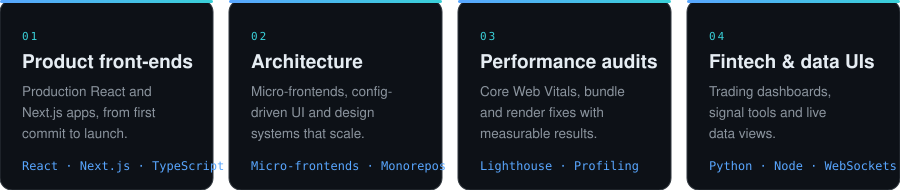
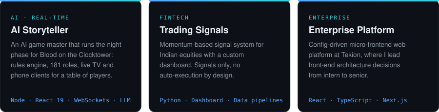

## What I do

I'm a senior front-end engineer who has spent 5+ years taking enterprise web platforms
from first commit to production at **Tekion**, from intern to leading architecture decisions.
Now I'm taking on a small number of freelance projects where speed, polish and
maintainability all matter.

## Selected work

Most of my work lives in private repos. Walkthroughs and code samples are available on request.

## How we'd work together

| 1. Scope | 2. Build | 3. Ship | 4. Support |
|---|---|---|---|
| A short call, a written plan, a fixed price or clear estimate | Weekly demos, preview links, no black boxes | Tested, typed, documented, deployed | Handover docs and a post-launch window |

## Stack

## Activity

## The journey

Off the clock I write, direct and act in short films and stage plays, and I'm usually at a board game table.

**Have a project in mind?** [Send me a message](mailto:rj1447@hotmail.com?subject=Project%20enquiry) and I'll reply within a day.

